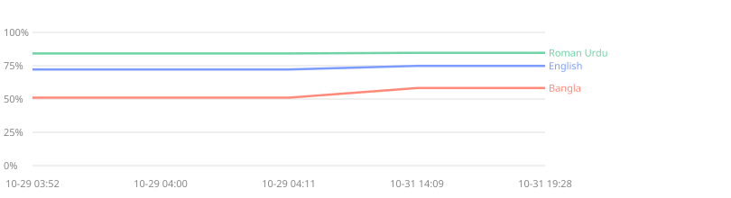

# Ward's eval history

Every committed run of Ward's benchmarks, kept as a time series on [Tiger Data](https://www.tigerdata.com) (Timescale Postgres),
so a change that helps one language and hurts another shows up instead of hiding behind an average.
Only scores are stored: no test sentences, no chats. 16 runs, 897 data points.

Written by `pnpm history:report`; recorded by `pnpm history:record`, which reads each result file's git history.
"Worse" means more than 3 points the wrong way since the run before.

## Got worse since the last run

- **redteam**, Gemma 4 E4B, bn: false alarm rate 10.0% → 15.0%
- **redteam**, Gemma 4 E4B, bn: false danger rate 0 → 10.0%
- **redteam**, Gemma 4 E4B, ur-Latn: danger recall 50.0% → 37.5%
- **scorecard**, Gemma 4 E2B, Bangla: accuracy 60.0% → 56.0%
- **scorecard**, Gemma 4 E2B, Bangla: f1 45.9% → 37.1%
- **scorecard**, Gemma 4 E2B, Bangla: precision 70.8% → 65.0%
- **scorecard**, Gemma 4 E2B, Bangla: recall 34.0% → 26.0%
- **scorecard**, Gemma 4 E2B, Roman Urdu: f1 45.8% → 42.3%
- **scorecard**, Gemma 4 E2B, Roman Urdu: precision 75.0% → 71.4%
- **scorecard**, Gemma 4 E2B, Roman Urdu: recall 33.0% → 30.0%
- **scorecard**, Gemma 4 E4B, English: precision 72.0% → 65.5%

## The phone tier's F1 per language, run by run

## Latest scores

### scorecard

| System | Language | Metric | Latest | Change | Commit |
|---|---|---|---|---|---|
| Gemma 4 E2B | Bangla | accuracy | 56.0% | worse -4.0 pts | `b629fb0` |
| Gemma 4 E2B | Bangla | f1 | 37.1% | worse -8.8 pts | `b629fb0` |
| Gemma 4 E2B | Bangla | precision | 65.0% | worse -5.8 pts | `b629fb0` |
| Gemma 4 E2B | Bangla | recall | 26.0% | worse -8.0 pts | `b629fb0` |
| Gemma 4 E2B | English | accuracy | 58.5% | worse -0.5 pts | `b629fb0` |
| Gemma 4 E2B | English | f1 | 42.8% | worse -1.8 pts | `b629fb0` |
| Gemma 4 E2B | English | precision | 68.9% | better +0.1 pts | `b629fb0` |
| Gemma 4 E2B | English | recall | 31.0% | worse -2.0 pts | `b629fb0` |
| Gemma 4 E2B | Roman Urdu | accuracy | 59.0% | worse -2.0 pts | `b629fb0` |
| Gemma 4 E2B | Roman Urdu | f1 | 42.3% | worse -3.6 pts | `b629fb0` |
| Gemma 4 E2B | Roman Urdu | precision | 71.4% | worse -3.6 pts | `b629fb0` |
| Gemma 4 E2B | Roman Urdu | recall | 30.0% | worse -3.0 pts | `b629fb0` |
| Gemma 4 E4B | Bangla | accuracy | 73.5% | same | `b629fb0` |
| Gemma 4 E4B | Bangla | f1 | 71.7% | better +0.6 pts | `b629fb0` |
| Gemma 4 E4B | Bangla | precision | 77.0% | worse -1.3 pts | `b629fb0` |
| Gemma 4 E4B | Bangla | recall | 67.0% | better +2.0 pts | `b629fb0` |
| Gemma 4 E4B | English | accuracy | 58.5% | worse -2.5 pts | `b629fb0` |
| Gemma 4 E4B | English | f1 | 46.5% | worse -1.5 pts | `b629fb0` |
| Gemma 4 E4B | English | precision | 65.5% | worse -6.5 pts | `b629fb0` |
| Gemma 4 E4B | English | recall | 36.0% | same | `b629fb0` |
| Gemma 4 E4B | Roman Urdu | accuracy | 85.5% | worse -0.5 pts | `b629fb0` |
| Gemma 4 E4B | Roman Urdu | f1 | 85.9% | worse -0.1 pts | `b629fb0` |
| Gemma 4 E4B | Roman Urdu | precision | 83.8% | worse -2.2 pts | `b629fb0` |
| Gemma 4 E4B | Roman Urdu | recall | 88.0% | better +2.0 pts | `b629fb0` |
| Phone: packs + Ward Lite | Bangla | accuracy | 67.0% | same | `b629fb0` |
| Phone: packs + Ward Lite | Bangla | f1 | 58.2% | same | `b629fb0` |
| Phone: packs + Ward Lite | Bangla | precision | 79.3% | same | `b629fb0` |
| Phone: packs + Ward Lite | Bangla | recall | 46.0% | same | `b629fb0` |
| Phone: packs + Ward Lite | English | accuracy | 71.5% | same | `b629fb0` |
| Phone: packs + Ward Lite | English | f1 | 74.9% | same | `b629fb0` |
| Phone: packs + Ward Lite | English | precision | 66.9% | same | `b629fb0` |
| Phone: packs + Ward Lite | English | recall | 85.0% | same | `b629fb0` |
| Phone: packs + Ward Lite | Roman Urdu | accuracy | 85.0% | same | `b629fb0` |
| Phone: packs + Ward Lite | Roman Urdu | f1 | 84.7% | same | `b629fb0` |
| Phone: packs + Ward Lite | Roman Urdu | precision | 86.5% | same | `b629fb0` |
| Phone: packs + Ward Lite | Roman Urdu | recall | 83.0% | same | `b629fb0` |
| ShieldGemma 2B | Bangla | accuracy | 56.5% | same | `b629fb0` |
| ShieldGemma 2B | Bangla | f1 | 24.3% | same | `b629fb0` |
| ShieldGemma 2B | Bangla | precision | 93.3% | same | `b629fb0` |
| ShieldGemma 2B | Bangla | recall | 14.0% | same | `b629fb0` |
| ShieldGemma 2B | English | accuracy | 56.0% | same | `b629fb0` |
| ShieldGemma 2B | English | f1 | 30.2% | same | `b629fb0` |
| ShieldGemma 2B | English | precision | 73.1% | same | `b629fb0` |
| ShieldGemma 2B | English | recall | 19.0% | same | `b629fb0` |
| ShieldGemma 2B | Roman Urdu | accuracy | 54.0% | same | `b629fb0` |
| ShieldGemma 2B | Roman Urdu | f1 | 23.3% | same | `b629fb0` |
| ShieldGemma 2B | Roman Urdu | precision | 70.0% | same | `b629fb0` |
| ShieldGemma 2B | Roman Urdu | recall | 14.0% | same | `b629fb0` |
| Slang packs | Bangla | accuracy | 54.0% | same | `b629fb0` |
| Slang packs | Bangla | f1 | 17.9% | same | `b629fb0` |
| Slang packs | Bangla | precision | 83.3% | same | `b629fb0` |
| Slang packs | Bangla | recall | 10.0% | same | `b629fb0` |
| Slang packs | English | accuracy | 54.5% | same | `b629fb0` |
| Slang packs | English | f1 | 18.0% | same | `b629fb0` |
| Slang packs | English | precision | 90.9% | same | `b629fb0` |
| Slang packs | English | recall | 10.0% | same | `b629fb0` |
| Slang packs | Roman Urdu | accuracy | 77.5% | same | `b629fb0` |
| Slang packs | Roman Urdu | f1 | 72.4% | same | `b629fb0` |
| Slang packs | Roman Urdu | precision | 93.7% | same | `b629fb0` |
| Slang packs | Roman Urdu | recall | 59.0% | same | `b629fb0` |
| Ward Lite | Bangla | accuracy | 64.5% | same | `b629fb0` |
| Ward Lite | Bangla | f1 | 53.0% | same | `b629fb0` |
| Ward Lite | Bangla | precision | 78.4% | same | `b629fb0` |
| Ward Lite | Bangla | recall | 40.0% | same | `b629fb0` |
| Ward Lite | English | accuracy | 71.0% | same | `b629fb0` |
| Ward Lite | English | f1 | 74.3% | same | `b629fb0` |
| Ward Lite | English | precision | 66.7% | same | `b629fb0` |
| Ward Lite | English | recall | 84.0% | same | `b629fb0` |
| Ward Lite | Roman Urdu | accuracy | 85.0% | same | `b629fb0` |
| Ward Lite | Roman Urdu | f1 | 84.0% | same | `b629fb0` |
| Ward Lite | Roman Urdu | precision | 89.8% | same | `b629fb0` |
| Ward Lite | Roman Urdu | recall | 79.0% | same | `b629fb0` |

### redteam

| System | Language | Metric | Latest | Change | Commit |
|---|---|---|---|---|---|
| Gemma 4 E2B | all | danger recall | 23.7% | new | `b629fb0` |
| Gemma 4 E2B | all | false alarm rate | 6.0% | new | `b629fb0` |
| Gemma 4 E2B | all | false danger rate | 0.8% | new | `b629fb0` |
| Gemma 4 E2B | all | recall | 28.9% | new | `b629fb0` |
| Gemma 4 E4B | all | danger recall | 44.7% | better +2.6 pts | `b629fb0` |
| Gemma 4 E4B | all | false alarm rate | 21.8% | same | `b629fb0` |
| Gemma 4 E4B | all | false danger rate | 3.8% | worse +1.5 pts | `b629fb0` |
| Gemma 4 E4B | all | recall | 80.3% | better +5.6 pts | `b629fb0` |
| Phone: packs + Ward Lite | all | danger recall | 47.4% | same | `b629fb0` |
| Phone: packs + Ward Lite | all | false alarm rate | 27.8% | same | `b629fb0` |
| Phone: packs + Ward Lite | all | false danger rate | 6.0% | same | `b629fb0` |
| Phone: packs + Ward Lite | all | recall | 52.8% | same | `b629fb0` |
| Slang packs | all | danger recall | 7.9% | same | `b629fb0` |
| Slang packs | all | false alarm rate | 21.8% | same | `b629fb0` |
| Slang packs | all | false danger rate | 4.5% | same | `b629fb0` |
| Slang packs | all | recall | 20.4% | same | `b629fb0` |
| Ward Lite | all | danger recall | 39.5% | same | `b629fb0` |
| Ward Lite | all | false alarm rate | 11.3% | same | `b629fb0` |
| Ward Lite | all | false danger rate | 3.8% | same | `b629fb0` |
| Ward Lite | all | recall | 40.1% | same | `b629fb0` |

### chats

| System | Language | Metric | Latest | Change | Commit |
|---|---|---|---|---|---|
| Computer: lists + Gemma 4 E4B | all | exact | 71.9% | new | `97e7ecb` |
| Computer: lists + Gemma 4 E4B | all | false urgent rate | 11.0% | new | `97e7ecb` |
| Computer: lists + Gemma 4 E4B | all | missed urgent rate | 10.7% | new | `97e7ecb` |
| Phone: lists + Ward Lite | all | exact | 39.1% | same | `97e7ecb` |
| Phone: lists + Ward Lite | all | false urgent rate | 21.0% | same | `97e7ecb` |
| Phone: lists + Ward Lite | all | missed urgent rate | 50.0% | same | `97e7ecb` |
| Word lists | all | exact | 37.5% | same | `97e7ecb` |
| Word lists | all | false urgent rate | 5.0% | same | `97e7ecb` |
| Word lists | all | missed urgent rate | 82.1% | same | `97e7ecb` |

### everyday

| System | Language | Metric | Latest | Change | Commit |
|---|---|---|---|---|---|
| ward-lite | bn | false alarm rate | 2.4% | new | `6a42ded` |
| ward-lite | bn | urgent rate | 2.4% | new | `6a42ded` |
| ward-lite | en | false alarm rate | 6.0% | new | `6a42ded` |
| ward-lite | en | urgent rate | 2.4% | new | `6a42ded` |
| ward-lite | hi-Latn | false alarm rate | 5.0% | new | `6a42ded` |
| ward-lite | hi-Latn | urgent rate | 1.3% | new | `6a42ded` |
| ward-lite | ur-Latn | false alarm rate | 6.2% | new | `6a42ded` |
| ward-lite | ur-Latn | urgent rate | 2.5% | new | `6a42ded` |

### secondlook

| System | Language | Metric | Latest | Change | Commit |
|---|---|---|---|---|---|
| gemma4:e2b | all | cleared rate | 58.6% | new | `0fe5dbe` |
| gemma4:e2b | all | dangerous cleared | 1 | new | `0fe5dbe` |
| gemma4:e2b | all | false alarms cleared rate | 95.8% | new | `0fe5dbe` |
| gemma4:e2b | all | harm cleared rate | 39.1% | new | `0fe5dbe` |
| gemma4:e2b | all | seconds | 25.8 | new | `0fe5dbe` |
| gemma4:e4b | all | cleared rate | 34.3% | new | `0fe5dbe` |
| gemma4:e4b | all | dangerous cleared | 0 | new | `0fe5dbe` |
| gemma4:e4b | all | false alarms cleared rate | 91.7% | new | `0fe5dbe` |
| gemma4:e4b | all | harm cleared rate | 4.3% | new | `0fe5dbe` |
| gemma4:e4b | all | seconds | 65.2 | new | `0fe5dbe` |

